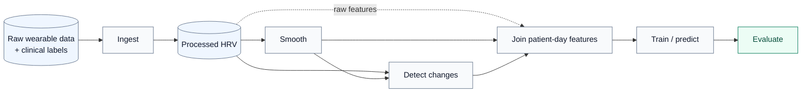
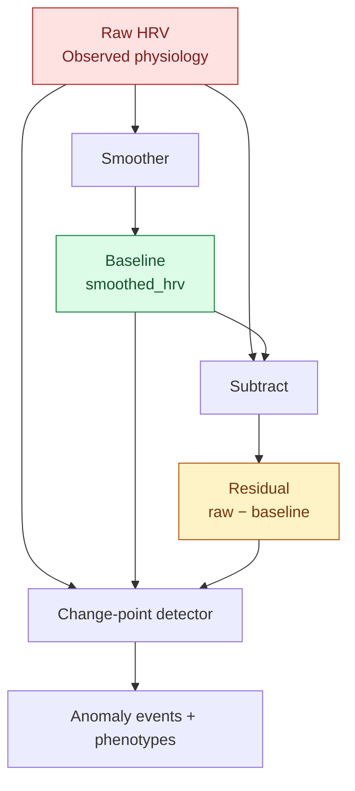
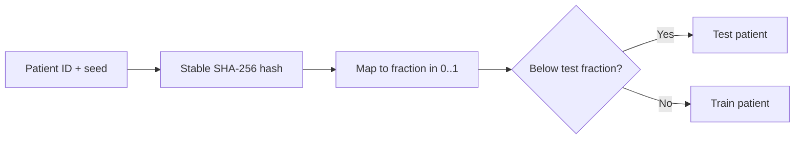
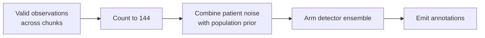
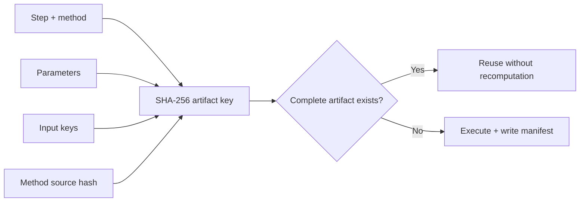

<div align="center">

# Wearable Exacerbation Early-Warning Pipeline

**From irregular smartwatch HRV to reproducible, patient-level respiratory exacerbation research.**

A modular framework for **gap-aware signal processing**, **change-point detection**, and **early-warning modelling** on longitudinal wearable data.


[Quickstart](#quickstart) · [Architecture](#architecture) · [Method catalogue](#method-catalogue) · [Results](#reference-results) · [Extend the pipeline](#extending-the-pipeline)

</div>

---

> [!IMPORTANT]
> **Research software, not a clinical alerting system.** This repository investigates whether noisy, intermittently observed wearable HRV contains useful signals for respiratory exacerbations. Current results are exploratory, and **8 of 10 smoothers have a known future-information leakage path** through whole-frame parameter estimation. See [Causality audit](#causality-audit) before interpreting results as prospective early warnings.

## Overview

Consumer smartwatches do not produce clean, continuous physiological time series. HRV is sampled intermittently, measurements are noisy, and devices may be removed for hours or days. Respiratory exacerbations are comparatively rare, making both signal processing and evaluation difficult.

This repository keeps those problems separate. It lets you smooth HRV, detect changes, create patient-day features, train models, and evaluate predictions **independently or in any supported combination**.

| Study | Scale | Available methods | Design |
|:--|:--|:--|:--|
| AIIMS asthma + COPD | **221** enrolled/included patient records; **191** with usable HRV | **10** smoothers · **4** CPD detectors | Per-patient, gap-aware processing |
| Smartwatch signal | SDNN-based HRV, approximately every **10 minutes** | Raw · smoothed · residual inputs | Patient-level train/test separation |
| Labels | **15,691** sample days; **144** exacerbation days | Detection · 1–3-day onset | Content-addressed, traceable artifacts |
| Baseline model | Logistic regression | **8** metrics, split across model and signal quality | Plug-in architecture and reusable runs |

**Asthma is the first study, not the package identity.** The reusable code is `wearable/`; the data source and cohort are configurable.

### What makes this repository different?

1. **Run only what you need.** Benchmark a smoother without training a model, run CPD directly on raw data, or skip both stages.
2. **Choose the signal per detector.** Feed CPD raw HRV, the smoothed baseline, or the residual. No representation is assumed to be best.
3. **Respect gaps.** Long missing intervals split time series and reset filter state, rather than being interpreted as physiological transitions.
4. **Trace every result.** Each generated artifact has a manifest describing its parameters, inputs, code, and lineage.
5. **Compare fairly.** A stable, patient-level split prevents train/test patient overlap and holds assignments fixed across methods.

## Contents

- [Quickstart](#quickstart)
- [Architecture](#architecture)
  - [Composable pipeline](#composable-pipeline)
  - [Raw, baseline, and residual](#raw-baseline-and-residual)
  - [Gap-aware segmentation](#gap-aware-segmentation)
- [Repository structure](#repository-structure)
- [Method catalogue](#method-catalogue)
- [Running experiments](#running-experiments)
- [Evaluation and comparison](#evaluation-and-comparison)
- [Reference results](#reference-results)
- [Cold start and arming](#cold-start-and-arming)
- [Data and labels](#data-and-labels)
- [Artifact schemas](#artifact-schemas)
- [Provenance and caching](#provenance-and-caching)
- [Configuration](#configuration)
- [Reproducibility and performance](#reproducibility-and-performance)
- [Causality audit](#causality-audit)
- [Extending the pipeline](#extending-the-pipeline)
- [Limitations and roadmap](#limitations-and-roadmap)
- [Dependencies](#dependencies)
- [Glossary and references](#glossary-and-references)

---

## Quickstart

**Requirements:** Python 3.10 and the project dependencies. Run commands from the repository root.

```bash
python3 -m venv .venv
source .venv/bin/activate
pip install -r requirements.txt

# Discover available methods and validate architectural constraints.
python -m wearable list
python -m wearable selftest
```

> [!TIP]
> On Apple Silicon or in non-interactive shells, call `.venv/bin/python` explicitly if activation does not select the virtual environment. This avoids accidentally loading an incompatible system NumPy build.

### Pick a starting point

| I want to… | Command |
|:--|:--|
| Prepare source HRV and day-level labels | `python -m wearable ingest` |
| Run the full default smoother-based experiment | `python -m wearable all gammadglm` |
| Go from raw features directly to the model | `python -m wearable chain` |
| Smooth HRV only | `python -m wearable smooth gammadglm --deltrend 0.995` |
| Detect changes on raw HRV | `python -m wearable detect --on raw` |
| Compare all smoothers | `python -m wearable sweep smoothing` |
| Inspect available runs | `python -m wearable runs` |
| Trace a model back to its inputs | `python -m wearable lineage model:logreg` |

**A successful rerun with identical inputs and settings reuses existing complete artifacts.** Pass `--force` when you explicitly want to recompute.

<details>
<summary><strong>More CLI examples</strong></summary>

```bash
# Select signal and CPD methods.
python -m wearable detect --on residual --smoothing gammadglm --methods bocpd,kcpd

# Build day-level features from selected artifacts.
python -m wearable join --artifacts smooth:gammadglm,detect:bocpd --target detection

# Train and evaluate independently.
python -m wearable model join:smooth:gammadglm --model logreg
python -m wearable evaluate model:logreg

# Controlled comparison modes.
python -m wearable sweep cpd
python -m wearable sweep signal
python -m wearable sweep smoothers-no-model

# Render patient and cohort reports.
python scripts/plot_patient.py smooth:gammadglm a001
python scripts/smoother_comparison_report.py 0010
python scripts/eda.py
python scripts/eda.py a001
```

For fast exploratory sweeps, use `--limit 40` where supported. The limit is included in the artifact key, so partial-cohort results cannot silently replace full-cohort results.

</details>

---

## Architecture

### Composable pipeline

There are **six processing steps**, connected by one orchestration module, `wearable/experiment.py`. Step modules do not import one another. Their inputs and outputs form the contract.



Each branch is **selectable**, not mandatory. For example, `join` can consume raw features alone, smoothed data, CPD outputs, or combinations exposed by the runner. Ingest remains the common preparation stage for the default source.

### Raw, baseline, and residual

HRV has at least three potentially useful representations. Treating them as interchangeable experimental inputs avoids committing to an untested assumption.



| Representation | Captures | Main trade-off |
|:--|:--|:--|
| **Raw** `hrvValue` | Actual recorded variation | Noisy; circadian rhythm and drift may trigger false changes |
| **Baseline** `smoothed_hrv` | Slower physiological variation | Aggressive smoothing may erase meaningful excursions |
| **Residual** `residual_hrv` | Difference between observations and estimated baseline | Depends on baseline quality; not guaranteed to be exactly zero-mean or free of circadian effects |

The fundamental decomposition is:

$$
\text{residual\_hrv}_t = \text{hrvValue}_t - \text{smoothed\_hrv}_t.
$$

Select the CPD input with `detect --on raw|smoothed|residual`. Use `sweep signal` to test the choice instead of assuming residuals always perform better.

### Gap-aware segmentation

Wearable missingness is **not necessarily random**: charging, device removal, sleep, and non-compliance can all interrupt collection. A gap of **180 minutes or more** opens a new chunk and resets smoothing and detection state.

```text
Readings     ●──●──●────●                         ●──●──●
Time         ────────────···· 4-hour gap ·······──────────
Chunk ID         1                                 2
                                                  ↑ reset state
```

Gaps shorter than 180 minutes remain inside the current chunk and are handled as irregular sampling. The first observation starts `chunk_id = 1`. Calibration can accumulate *valid observations across chunks*, even though filter state resets between them.

> **Boundary detail:** ingest inserts gap-filler rows for gaps **greater than** 180 minutes, while segmentation starts a new chunk for gaps **greater than or equal to** 180 minutes. An exactly 180-minute gap therefore splits without receiving filler rows. This behavior is deliberately retained for reproducibility.

---

## Repository structure

```text
asthma-prediction/
├── README.md
├── CLAUDE.md
├── requirements.txt
├── main.tex
├── wearable/                         # Reusable Python package
│   ├── __main__.py                   # CLI
│   ├── experiment.py                 # Only cross-step orchestrator
│   ├── config.py                     # Shared constants, paths, seed, storage
│   ├── chunking.py                   # Central gap / chunk policy
│   ├── registry.py                   # Auto-discovery of method modules
│   ├── store.py                      # Manifest, artifact keys, cache, I/O
│   ├── sources.py                    # Source-specific patient loaders
│   ├── smoothing/                    # Pool 1: smoothing methods
│   ├── cpd/                          # Pool 2: change-point detectors
│   ├── models/                       # Pool 3: prediction models
│   ├── metrics/                      # Pool 4: evaluation metrics
│   ├── steps/                        # ingest / smooth / detect / join / model / evaluate
│   └── selftest.py                   # Architecture + behavior checks
├── scripts/                          # Diagnostics and HTML reports
├── tests/                            # Smoke and invariant tests
├── docs/                             # Research / method documentation
├── legacy/                           # Retired implementations
└── data/                             # Gitignored: sensitive or generated
    ├── raw/pass1/                   # Original study input
    ├── processed/                   # Canonical ingest output and labels
    ├── runs/<step>/<method>/<key>/  # Current complete/incomplete artifacts
    ├── reports/                     # Regenerable figures / HTML
    ├── logs/                        # Run logs
    └── old/                         # Archived results, not read by pipeline
```

**Naming:** lowercase `snake_case` for files and directories. Data paths describe their lifecycle. Per-patient artifact tables use `<pid>__<step>_<method>.<ext>`.

---

## Method catalogue

The registry discovers methods from Python modules in four directories. No central method list needs editing.

| Pool | Directory | Required entry point |
|:--|:--|:--|
| Smoothing | `wearable/smoothing/` | `smooth_dataframe(...)` |
| Change-point detection | `wearable/cpd/` | `detect(...)` |
| Models | `wearable/models/` | `fit(...)` and `predict_proba(...)` |
| Metrics | `wearable/metrics/` | `compute(...)` and `KIND` |

Modules beginning with `_` or lacking the required functions are ignored. An import failure is reported as an unavailable method, rather than crashing discovery. Optional metadata such as `LABEL`, `DEFAULTS`, and `CONFIG` allows methods to surface their settings automatically.

### 1. Smoothing: physiological baseline

**Contract**

```python
smooth_dataframe(
    df, patient_col, timestamp_col, value_col, config, out_col
) -> DataFrame
```

The smoother processes each chunk independently, initializes fresh state at boundaries, and emits a strictly positive baseline. **Important:** forward filtering alone does not prove that its entire implementation is causal; see [Causality audit](#causality-audit).

| Key | Method | Selected default parameters | Truncation-exact in current test |
|:--|:--|:--|:--:|
| `anrewma` | Adaptive-norm robust EWMA | `norm_alpha=0.05`, `ewma_c=1.0` | **Yes** |
| `ctimm` | Continuous-time interacting multiple model | `q_scale=0.001`, `stickiness=0.95` | **Yes** |
| `gammadglm` | Gamma conjugate-discount DGLM **(pipeline default)** | `deltrend=0.99`, `delseas=0.99`, `shape_scale=1.0` | No |
| `gpssm` | State-space Gaussian process | `q_scale=0.05`, `r_scale=5.0` | No |
| `hrkf` | Huber robust Kalman filter | `deltrend=0.99`, `delseas=0.99`, `huber_delta=1.345` | No |
| `kim` | Kim Markov-switching state-space model | `q_scale=0.1`, `r_scale=3.0` | No |
| `krlst` | Kernel recursive least-squares tracker | `budget=100`, `forgetting_lambda=0.995` | No |
| `logmhw` | Log multiplicative Holt-Winters | `alpha=0.08`, `gamma=0.02`, `optimize=True` | No |
| `ossa` | Online singular spectrum analysis | `window_max=144`, `n_components=2` | No |
| `rspf` | Regime-switching particle filter | `K=3`, `n_particles=500` | No |

Structural parameters were tuned on patient `0010`'s densest three-day window. Observed range, robust noise scale (MAD), log-mean, and median sampling interval are derived per patient (H10), although some derivations currently see the full frame.

> [!NOTE]
> The older `pf` implementation uses a backward FFBS smoothing pass. It is **non-causal** and intentionally excluded from the active registry. For offline comparison only, see `legacy/run_pf_filters.py`.

### 2. Change-point detection: unusual behavior

**Contract**

```python
detect(time, values, priors) -> {
    "anomaly": ..., "phenotype": ..., "magnitude": ..., "severity": ...
}
# priors contains m0 and sigma0, estimated from patient/population calibration
```

| Key | Algorithm | Reported phenotype(s) | Important constants |
|:--|:--|:--|:--|
| `bocpd` | Bayesian online change-point detection | Mean shift; variance change | `HAZARD_LAMBDA=1000`, `MIN_RUN=6`, `DROP_FRAC=0.5` |
| `kcpd` | Studentized two-window MMD | Distribution shift | `WINDOW=18`, `N_PERM=80`, `STRIDE=3`, `MIN_EFFECT_Z=10.0` |
| `kalman` | Innovation CUSUM + autocorrelation | Volatility spike; gradual drift; autocorrelation change | `CUSUM_H=3.0`, `CUSUM_K=0.5`, `ACF_WIN=12`, `ACF_H=0.6` |
| `hmm` | Two-state Gaussian HMM | State transition | `STICKINESS=0.95`, `STATE1_VAR_MULT=9.0` |

<details>
<summary><strong>Detection logic and exact phenotype names</strong></summary>

| Detector | Detection rule | Output phenotype(s) |
|:--|:--|:--|
| `bocpd` | A run-length posterior collapse; mean shift versus spread change determines the label | `BOCPD_Mean_Shift`, `BOCPD_Variance_Change` |
| `kcpd` | Two-window MMD exceeds the null-scale threshold `MIN_EFFECT_Z` | `KCPD_Distribution_Shift` |
| `kalman` | Innovation / CUSUM threshold crossings or elevated rolling lag-1 autocorrelation | `Kalman_Volatility_Spike`, `Kalman_Gradual_Drift`, `Kalman_Autocorrelation_Change` |
| `hmm` | Decoded transition into the higher-variance regime | `HMM_State_Transition` |

</details>

**How alarms are combined**

- **Ensemble alarm:** `anomaly_present` is the logical OR of detector outputs (recall-oriented screening).
- **Primary event:** the firing detector with the highest `severity` provides `primary_phenotype` and `magnitude`; ties are resolved by detector order.
- **Auditability:** per-detector anomaly, phenotype, and magnitude fields remain available.

**Count events, not just rows.** An HMM may flag an entire abnormal regime. Ten flagged samples in one contiguous interval are not necessarily ten independent events. The logs report both flagged-row counts and distinct contiguous runs.

**Causality note:** full-sequence Viterbi decoding can use future observations. Treat the HMM branch as potentially retrospective until its inference mode is verified or replaced with forward filtering.

### 3. Prediction model

**Contract**

```python
fit(X, y, seed, **params) -> fitted
predict_proba(fitted, X) -> array_of_probabilities
```

| Key | Current implementation | Why it is used |
|:--|:--|:--|
| `logreg` | Logistic regression; median imputation; standardization; `class_weight="balanced"` | Fast, transparent model for isolating the effect of preprocessing and CPD features |

Because exacerbation days are approximately **1%** of labeled sample days, the baseline explicitly addresses class imbalance. This is a research baseline, not a claim that logistic regression is the best architecture.

### 4. Evaluation metrics

Metrics are plug-ins with `KIND = "model"` or `KIND = "signal"` and `HIGHER_IS_BETTER`.

| Metric | Kind | Interpretation | Desired direction |
|:--|:--|:--|:--|
| `auroc` | Model | Ranking of positive vs negative days across thresholds | ↑ |
| `auprc` | Model | Precision-recall performance; especially relevant at low prevalence | ↑ |
| `brier` | Model | Mean squared error of predicted probabilities; reflects probability accuracy | ↓ |
| `variance_reduction` | Signal | Fraction of raw HRV variance removed | ↑, **with caution** |
| `roughness_reduction` | Signal | Decrease in average absolute first differences | ↑ |
| `peak_preservation` | Signal | Median fraction of local raw-peak excursion retained | ↑ |
| `correlation` | Signal | Pearson correlation between raw and smoothed HRV | ↑ |
| `mean_error_pct` | Signal | Difference between smoothed and raw signal means | ↓ |

**Never optimize smoothness alone.** A method can reduce 97% of variance by flattening physiology. Read `variance_reduction` together with `peak_preservation`, and validate with downstream model outcomes.

---

## Running experiments

The stages can be invoked separately, assembled into an experiment, or systematically swept.

### Common workflows

```bash
# 1. Ingest once.
python -m wearable ingest

# 2A. Run a smoother only.
python -m wearable smooth gammadglm --deltrend 0.995

# 2B. Or detect on unsmoothed observations.
python -m wearable detect --on raw

# 2C. Or detect on an existing smoothed residual.
python -m wearable detect --on residual --smoothing gammadglm --methods bocpd,kcpd

# 3. Join chosen artifacts into patient-day feature tables.
python -m wearable join --artifacts smooth:gammadglm,detect:bocpd --target detection

# 4. Train a model and evaluate its probabilities.
python -m wearable model join:smooth:gammadglm --model logreg
python -m wearable evaluate model:logreg
```

### Run comparisons

```bash
python -m wearable sweep smoothing          # 10 smoothers + raw baseline
python -m wearable sweep cpd                # compare detectors
python -m wearable sweep signal             # raw vs smoothed vs residual
python -m wearable sweep smoothers-no-model # model-free signal diagnostics
```

Sweeps fix the target, the model, its seed, and patient split assignments. If a preprocessing method excludes patients, the *assignment* remains the same, but the evaluated set can become smaller. Use a **common eligible patient set** for a strict equal-sample comparison.

### Reports

```bash
python scripts/plot_patient.py smooth:gammadglm a001  # PNG + interactive HTML
python scripts/smoother_comparison_report.py 0010    # all methods for one patient
python scripts/eda.py                               # cohort-level EDA
```

### Pause, resume, and storage

- **Interrupt safely:** `Ctrl-C` preserves completed artifacts. A partially written artifact remains `status: running` and is **not** reused.
- **Resume naturally:** repeat the command; completed computations are reused and incomplete work is rerun.
- **Change table format:** set `WEARABLE_FORMAT=parquet` or `config.STORE_FORMAT` (`csv` by default). New backends implement entries in `store._WRITERS` and `store._READERS`.

---

## Evaluation and comparison

### Patient-level splitting

For each patient identifier, a deterministic hash based on the **seed and patient ID** assigns the patient to train or test:



This avoids splitting different days from the same patient across train and test. Adding patients does not reshuffle existing patient assignments. The patient universe remains defined by the labels, not by whichever method happened to emit features.

### Tasks and outcomes

| Task | Unit of prediction | Positive class |
|:--|:--|:--|
| **Detection** | Eligible patient-day | The day is labeled an exacerbation day |
| **Onset** | Onset-eligible patient-day | A new exacerbation episode starts in the next **1–3 days** |

The model produces `y_prob = P(y = 1)` for each evaluated patient-day. AUROC tests the **ranking** of positive versus negative days; AUPRC evaluates precision-recall across score thresholds; the Brier score tests probability accuracy. At a roughly 1% detection prevalence, AUPRC must be read against that low base rate.

---

## Reference results

The following are **archived experiment results**, not a claim that the current `data/runs/` directory contains these artifacts. They come from the last full detection sweep before the data reset, with **logistic regression, seed 42**, and the same assigned test patients.

<details open>
<summary><strong>Model-based smoothing comparison</strong></summary>

| Variant | AUPRC ↑ | AUROC ↑ | Day features |
|:--|--:|--:|--:|
| **`anrewma`** | **0.0256** | 0.6515 | 21 |
| **`ctimm`** | 0.0218 | **0.6534** | 21 |
| `gammadglm` | 0.0178 | 0.6403 | 21 |
| `gpssm` | 0.0150 | 0.6173 | 21 |
| *No smoothing (raw)* | 0.0149 | 0.5916 | 9 |

**Split:** 10,873 training days / 127 patients; 4,818 test days / 64 patients; 50 positive test days. **Test prevalence:** 1.04%.

</details>

<details>
<summary><strong>Model-free signal comparison</strong></summary>

| Variant | Peak preservation ↑ | Variance reduction ↑ | Raw correlation ↑ | Mean error % ↓ |
|:--|--:|--:|--:|--:|
| `gammadglm` | 0.394 | 47.4% | 0.724 | 3.0 |
| `gpssm` | **0.010** | 96.6% | 0.220 | 9.7 |

This is a warning, **not a win for `gpssm`**: it retains approximately 1% of peak excursion while suppressing almost all variability. For an early-warning task, lower noise is useful only if relevant changes survive.

</details>

**Interpretation:** `anrewma` and `ctimm`, the two truncation-exact smoothers in the current test, lead this particular archived model comparison. Even the leading AUPRC is low in absolute terms. These results support **further research**, not clinical deployment or a general claim of superiority.

Reproduce with `python -m wearable sweep smoothing` and `python -m wearable sweep smoothers-no-model`, subject to the same input cohort and environment. The archived run is under `data/old/`; the supplied repository state reports only `data/raw/pass1/` as current input.

---

## Cold start and arming

A change detector needs a noise estimate before treating fluctuations as anomalous. That estimate varies across patients and devices, so the pipeline calibrates before enabling alarms.



- **Burn-in:** `BURN_IN_N = 144` valid observations, counted cumulatively across chunks. At nominal 10-minute spacing that is 24 hours of observations, **not necessarily one continuous day or complete circadian coverage**.
- **Population shrinkage:** prior scale uses the median robust per-patient residual standard deviation, with `POP_N0 = 30` pseudo-observations.
- **Fallback:** `POP_SIGMA0_DEFAULT = 15.0` if no population median is available.
- **Gate:** while calibrating, alarms are suppressed and phenotype is `burn_in`. A patient with fewer than 144 valid samples never arms.
- **Downstream priors:** the estimated `sigma0` initializes BOCPD variability, Kalman measurement noise, and HMM emission scales.

The variance-style shrinkage rule is:

```text
sigma0² = (POP_N0 · sigma_pop² + n · sigma_obs²) / (POP_N0 + n)
```

At the 144-sample threshold, the patient contributes most of the weight, while the prior still protects against unstable small-sample estimates. In the documented cohort, **11 of 191** usable-HRV patients did not reach the arming threshold; **180** did.

---

## Data and labels

### Input sources

| Source | Location | Description | Clinical labels |
|:--|:--|:--|:--:|
| **`pass1`** (default) | `data/raw/pass1/<cohort>/<pid>.csv.gz` | AIIMS adults, children and COPD; 221 `in_models` records | Yes |
| `spark` | `data/raw/spark/<pid>/hrv/*.csv` | Historical 109-patient format and ID scheme | No |

The `pass1` `hrv` value maps to the older `hrvValue` field. It represents device-reported SDNN over approximately 10 minutes, measured roughly once per 10 minutes, with reported values capped by the device at 129.

| Cohort accounting | Count |
|:--|--:|
| Included patient records | **221** |
| Patients with surviving HRV | **191** |
| Patients without surviving HRV (though HR may exist) | **30** |
| Patients meeting detector arming threshold | **180** |

> [!WARNING]
> **Patient identifiers overlap across input sources.** There are 63 collisions (for example, `a001` and `p017`). Keep cohorts source-scoped in stage directories and joins. `data/raw/pass1/README.md` is the authoritative input-cohort reference.

### Ground-truth table

**File:** `data/processed/labels_pass1.csv`

```text
p_id, date, exac_day, episode, sample, label, onset_valid, onset_label, onset_id
```

| Label statistic | Count |
|:--|--:|
| Sample patient-days | **15,691** |
| Exacerbation days | **144** |
| Onset-labeled days | **151** |
| Episodes | **100** |

The day-level labels are extracted **before HRV filtering**. Thus, an exacerbation day with no wearable reading remains in the ground-truth table. Labels do not pass through smoothers or detectors and are joined on `(p_id, date)` when constructing modelling tables.

**Privacy:** all patient data under `data/` is sensitive and gitignored. Do not commit raw tables, processed patient-level features, generated artifacts, or identifiable logs.

---

## Artifact schemas

The artifact store provides standardized tables for each stage.

| Step | Output table(s) | Important columns |
|:--|:--|:--|
| `smooth` | `smoothed` | `p_id`, `createdTime`, `hrvValue`, `minute_diff`, `smoothed_hrv`, `residual_hrv`, `gap_flag`, `chunk_id` |
| `detect` | `detected` | `p_id`, `createdTime`, signal, `chunk_id`, `armed`, per-detector outputs, `anomaly_present`, `primary_phenotype`, `magnitude`, `sigma0` |
| `join` | `train`, `test`, `split` | `p_id`, `date`, engineered features, `y`; split assignments |
| `model` | `predictions` | `p_id`, `date`, `y`, `y_prob` |
| `evaluate` | `metrics` | `metric`, `kind`, `label`, `value`, `higher_is_better` |

**Important field semantics**

- `hrvValue`: raw SDNN, `NaN` for synthetic gap-filler rows.
- `minute_diff`: elapsed minutes since the previous observation.
- `smoothed_hrv`: strictly positive smoother output.
- `residual_hrv`: raw minus smoothed HRV.
- `gap_flag`: indicator for inserted filler rows.
- `chunk_id`: per-patient segment number, incremented at long gaps.
- `<method>_anomaly`, `<method>_phenotype`, `<method>_magnitude`: detector-specific fields.

`join` summarizes numeric channels with patient-day **mean / standard deviation / minimum / maximum**, while anomaly flags contribute both flagged-row counts and distinct contiguous-event counts.

---

## Provenance and caching

Every step writes an **artifact directory**, containing output tables and a `manifest.json`. An artifact key incorporates the step, method, resolved parameters, input-artifact keys, and method source hash.



Editing a method invalidates that method's artifact; changing a parameter, input, or source hash changes the key. Downstream artifacts reference their upstream keys and can therefore be traced back through a DAG.

<details>
<summary><strong>Example manifest</strong></summary>

```json
{
  "step": "smooth",
  "method": "anrewma",
  "params": { "norm_alpha": 0.05, "ewma_c": 1.0 },
  "inputs": [
    { "step": "ingest", "method": "processed_dir", "key": "data/processed" }
  ],
  "code": {
    "method_source_hash": "2cebc14a0b48e5a4",
    "git_rev": "4b7f9bdb94d475c579a7040965230a95e6a4ab5d",
    "git_dirty": true
  },
  "format": "csv",
  "status": "complete",
  "tables": ["smoothed", "failures"]
}
```

</details>

```bash
python -m wearable runs
python -m wearable lineage model:logreg
```

Example lineage:

```text
model/logreg              key=88138a191357
  join/smooth:gpssm        key=a09df43e8894
    smooth/gpssm           key=9b341787f9ab
```

**Cache correctness depends on declaring all result-affecting inputs.** The Git revision and dirty flag are recorded for provenance; the documented content-key inputs include the *method source hash*. Parameters such as patient limit and preprocessing settings must also be included wherever they affect an output.

---

## Configuration

Shared knobs live in `wearable/config.py`; each algorithm defines its own `DEFAULTS` or constants locally.

| Setting | Default | Role |
|:--|:--|:--|
| `GAP_THRESHOLD_MIN` | `180.0` | Start a new chunk at gaps ≥ 180 minutes |
| `FILL_INTERVAL_MIN` | `10` | Synthetic NaN-HRV filler cadence |
| `MIN_SEGMENT_ROWS` | `10` | Smaller chunks are left unsmoothed |
| `BURN_IN_N` | `144` | Required valid samples before arming |
| `POP_N0` | `30` | Population-prior pseudo-count |
| `POP_SIGMA0_DEFAULT` | `15.0` | Prior fallback scale |
| `SEED` | `42` | Default experiment seed |
| `TEST_FRACTION` | `0.3` | Patient-level holdout fraction |
| `STORE_FORMAT` | `"csv"` | `csv` or `parquet`; `WEARABLE_FORMAT` overrides |

For a method-specific change, override a documented CLI parameter (for example, `--deltrend 0.995`). CPD decision thresholds are defined in the corresponding `wearable/cpd/*.py` modules.

**Centralized segmentation:** all smoothers use `wearable.chunking.assign_chunks()`. To change the *strategy*, edit that function rather than redefining the gap threshold across methods. Possible alternatives include fixed windows, sleep/wake boundaries, and activity-based segmentation. Preserve a monotone per-patient `chunk_id` output.

The repository previously duplicated `GAP_THRESHOLD_MIN` in 13 files and chunk assignment in 10. Tests now require centralized definitions.

---

## Reproducibility and performance

### Built-in invariants

Run:

```bash
python -m wearable selftest
```

| Rule | Guarantee / check |
|:--|:--|
| **Independent steps** | Only `wearable/experiment.py` connects stages; tests reject cross-step imports |
| **File-based registration** | A compatible new method can be discovered without editing a list |
| **Artifact provenance** | Manifests describe parameters, inputs, and code metadata; lineage traverses dependencies |
| **Content-keyed reuse** | Relevant input, setting, and code changes are checked against the cache key |
| **Controlled comparisons** | Patient assignments are seed/ID-derived, order-independent, and stable when cohorts grow |

### Deterministic execution

Particle filters seed their own generators; `kcpd` uses `np.random.default_rng(0)` for permutations; `hmm` uses `random_state=42`; prediction models accept an explicit seed. In the prior package restructure, identical-input comparisons yielded **192/192 processed**, **192/192 smoothed**, **192/192 calibrated**, and **188/188 annotated** files byte-identical before and after.

This is evidence for that tested setup, **not a universal byte-for-byte guarantee** across operating systems, dependency builds, and hardware.

### Performance notes

- `ingest` and `smooth` use a `ProcessPoolExecutor` with approximately `cpu_count - 1` workers; `detect` processes patients sequentially.
- KCPD permutations dominate detector runtime, approximately **O(T × N_PERM × window²)**. Increasing `STRIDE` or reducing `N_PERM` trades temporal resolution / statistical stability for speed.
- One reported full four-detector run took approximately **10–15 minutes for 188 patients** in the earlier setup, not a guaranteed runtime.
- `hrkf` is unusually slow on long series (**78–132 s per patient** in the reported cohort, versus **1.7 s** on patient `0010`); `ossa` and `krlst` are also relatively expensive. Use `--limit` for exploratory sweeps.
- `gpssm`, `logmhw`, and `anrewma` were sub-second per patient in the referenced measurements.

---

## Causality audit

**The architecture aims to support online inference. Not every current algorithm satisfies strict online causality.** This distinction matters because future-derived parameters can improve retrospective metrics without being available at the prediction time.

A simple empirical test is **prefix consistency**: run a smoother on a full series and on a truncated prefix. For any timestamp shared by both runs, a strictly causal and deterministic implementation with the same available initialization should produce the same value.

```text
Full input:     x1  x2  x3  x4  x5  x6  ...
Prefix input:   x1  x2  x3
Expected:       y1  y2  y3 must match in both runs
```

### Observed prefix discrepancies

| Method | Maximum absolute prefix-vs-full difference |
|:--|--:|
| **`anrewma`** | **0.000** |
| **`ctimm`** | **0.000** |
| `hrkf` | 0.002 |
| `gammadglm` | 0.052 |
| `ossa` | 0.111 |
| `kim` | 0.122 |
| `krlst` | 0.135 |
| `gpssm` | 0.172 |
| `rspf` | 0.388 |
| `logmhw` | 0.479 |

**Root cause:** eight methods filter forward but calculate per-patient parameters (MAD noise, observed range, log-mean, or median time interval) from the **entire supplied frame**. The value emitted at time `t` can therefore change when observations after `t` arrive. This behavior predates the repository restructuring.

**What to do:** estimate patient-specific quantities causally using an expanding window or a frozen calibration period. The retired `legacy/calibrate_adaptive_baseline.py` already demonstrates expanding calibration for the noise floor. Retest the complete `smooth → detect → join → model` chain, including the HMM inference mode, after these changes.

> [!CAUTION]
> Passing a finite truncation test is encouraging, but does not mathematically prove causality for all inputs. **Do not describe the entire current pipeline as leakage-free in a publication or prospective validation study.**

---

## Extending the pipeline

For a new algorithm, create one Python module in the appropriate pool and implement its interface. Its file will be discovered automatically if importable and compatible.

| Add | New module | Required API |
|:--|:--|:--|
| Smoother | `wearable/smoothing/<name>.py` | `smooth_dataframe(df, patient_col, timestamp_col, value_col, config, out_col)` |
| CPD detector | `wearable/cpd/<name>.py` | `detect(time, values, priors)` with four output arrays |
| Model | `wearable/models/<name>.py` | `fit(X, y, seed, **params)` + `predict_proba(fitted, X)` |
| Metric | `wearable/metrics/<name>.py` | `compute(...)`, `KIND`, `HIGHER_IS_BETTER` |
| Data adapter | `wearable/sources.py` | `patients()` / `load(pid)` plus a `Source(...)` registration |

Optional descriptors: `LABEL`, `DEFAULTS`, and for smoothers `CONFIG`. These make the algorithm visible in `wearable list`, experimental sweeps, and manifests.

<details>
<summary><strong>Contribution checklist</strong></summary>

- [ ] Keep step modules independent; orchestration belongs in `wearable/experiment.py`.
- [ ] Use `assign_chunks()` from `wearable.chunking`; do not duplicate the gap threshold.
- [ ] Reset filtering state at each chunk and emit a strictly positive smoothing output.
- [ ] Test prefix consistency; do not derive online parameters from unseen future rows.
- [ ] Prefer data-driven per-patient estimates to hard-coded scale assumptions.
- [ ] Declare every result-affecting parameter in the artifact key.
- [ ] Seed any randomness; propagate the experiment seed where appropriate.
- [ ] For metrics, return `float("nan")` when inputs are insufficient (for example, only one class).
- [ ] Add or update tests. If a smoother is prefix-exact, update `TRUNCATION_EXACT` in `wearable/selftest.py`.
- [ ] Run `python -m wearable selftest` before submitting changes.

</details>

---

## Limitations and roadmap

### Known limitations

| Area | Current constraint | Planned direction |
|:--|:--|:--|
| **Online causality** | 8/10 smoothers use future-dependent per-patient estimates | Expanding/frozen calibration; repeat truncation audit |
| **Detector inference** | Full-sequence HMM Viterbi may be retrospective | Forward filtering for online HMM state probabilities |
| **Calibration** | Adaptive stage 3a lives in legacy code and is not wired into active `detect` | Optional adaptive calibration stage |
| **Offline smoother** | `pf` uses backward FFBS and is not online-capable | Retain only for retrospective comparison |
| **Sparse wearables** | Patients with <144 valid samples do not arm | Study uncertainty-aware alternatives for short histories |
| **Multivariate events** | `KCP_Multivariate_Shift` is reserved but not active for a single residual channel | Joint HRV, SpO₂, activity, sleep signals when available |
| **Long-term adaptation** | Static 144-sample burn-in | Rolling, potentially 90-day patient baseline |
| **Screening logic** | OR fusion can over-fire | Human-in-the-loop detector weights and calibrated alerts |
| **Clinical performance** | AUPRC remains low in absolute terms | Stronger validation, event-based evaluation, calibrated forecasting |

The main research priority is **to close leakage before making prospective early-warning claims**. Better offline AUPRC is not useful if the deployed model would require observations from the future.

---

## Dependencies

**Runtime:** Python 3.10. Versions below reflect the supplied environment/requirements snapshot.

| Package | Version | Main use |
|:--|:--|:--|
| `numpy` | 1.26.4 | Numerical operations |
| `pandas` | 2.1.1 | Time series and tabular artifacts |
| `scipy` | 1.15.3 | Signal processing and linear algebra |
| `scikit-learn` | 1.6.1 | Baseline model, kernels, metrics |
| `statsmodels` | 0.14.5 | Holt-Winters implementation |
| `hmmlearn` | 0.3.3 | Gaussian HMM |
| `particles` | Unspecified | Legacy particle smoother |
| `matplotlib` | 3.7.3 | Static plots |
| `plotly` | 6.8.0 | Interactive HTML charts |
| `tqdm` | 4.64.0 | Progress display |
| `ruptures` | 1.1.10 | Legacy analysis; active `kcpd` is self-contained |

`pytest` is not pinned. The main built-in validation command is `python -m wearable selftest`; individual smoke-test functions can also be executed directly.

---

## Glossary and references

| Term | Meaning |
|:--|:--|
| **HRV / SDNN** | Heart-rate variability / standard deviation of normal-to-normal beat intervals; the watch-provided HRV measure |
| **Track A** | Estimated smoothed physiological baseline |
| **Track B** | Raw measured HRV |
| **Residual** | Raw HRV minus smoothed baseline |
| **Chunk** | Segment bounded by a gap of at least 180 minutes |
| **CPD** | Change-point detection: identifying changes in a signal's statistical behavior |
| **Arming** | Enabling alarms after 144 valid calibration readings |
| **Artifact** | Generated output tables and the accompanying provenance manifest |
| **Truncation-exact** | Empirical equality of full-run and prefix-run outputs over shared timestamps, for tested inputs |
| **H1 / H8 / H9 / H10** | Relevant design constraints: positive baseline / gap-aware segmentation / online causality / patient-specific adaptation |

### Foundational reading

- Adams, R. P., & MacKay, D. J. C. (2007). *Bayesian Online Changepoint Detection*. Basis for `bocpd`.
- Kim, C.-J. (1994). *Dynamic linear models with Markov-switching*. Background for `kim`.
- West, M., & Harrison, J. *Bayesian Forecasting and Dynamic Models*. Background for `gammadglm` and state-space filtering.
- Van Vaerenbergh et al. *Kernel Recursive Least-Squares Tracker*. Background for `krlst`.
- Golyandina, N., & Zhigljavsky, A. *Singular Spectrum Analysis*. Background for `ossa`.

---

<div align="center">

**An experiment framework first. A deployable early-warning system only after rigorous prospective validation.**

</div>
