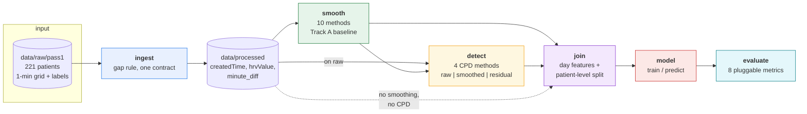
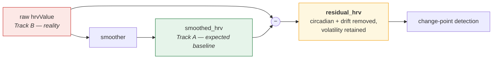
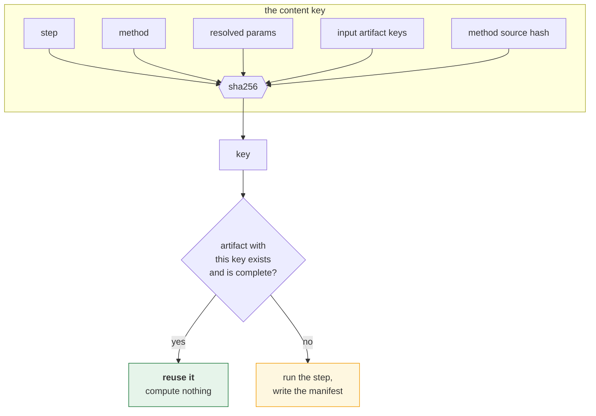
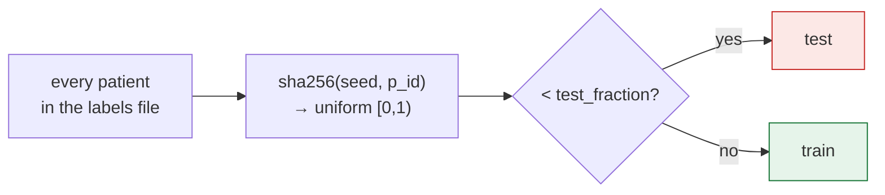

# Wearable Exacerbation Early-Warning Pipeline

> Continuous ambulatory **heart-rate variability** (10-minute SDNN from consumer
> smartwatches) → a causal, per-patient **early-warning signal** for respiratory
> exacerbations.

`Python 3.10` · `221 patients` · `AIIMS asthma + COPD` · causal / online · content-addressed
provenance · fully reproducible

Noisy, gap-ridden wearable HRV is turned into a smooth physiological **baseline**, a
mean-zero **residual** that exposes autonomic volatility, and **change-point
annotations** — then joined with clinical exacerbation labels, modelled, and scored.
Ten smoothing methods, four change-point detectors, swappable models and pluggable
metrics all sit behind one uniform contract, so any component can be replaced by adding
a single file.

**Asthma is the first study, not the repo's identity.** The package is `wearable`; the
cohort is a configuration.

---

## Contents

1. [How it works](#1-how-it-works)
2. [The five rules](#2-the-five-rules)
3. [Quickstart](#3-quickstart)
4. [Repository layout](#4-repository-layout)
5. [What's inside: the four pools](#5-whats-inside-the-four-pools)
6. [Provenance and reuse](#6-provenance-and-reuse)
7. [Comparing methods](#7-comparing-methods)
8. [Cold start and arming](#8-cold-start-and-arming)
9. [Data](#9-data)
10. [Output schemas](#10-output-schemas)
11. [Every constraint and where to change it](#11-every-constraint-and-where-to-change-it)
12. [What I'm using](#12-what-im-using)
13. [Findings worth knowing](#13-findings-worth-knowing)
14. [Reproducibility and performance](#14-reproducibility-and-performance)
15. [Contributing](#15-contributing)
16. [Limitations and roadmap](#16-limitations-and-roadmap)

---

## 1. How it works

### The pipeline

Five independent steps. No step imports another — `wearable/experiment.py` is the only
module that connects them, so each runs alone and they compose in any order.



Every arrow is optional. `python -m wearable chain` with no arguments sends the raw
signal straight to the model — the baseline that tells you whether smoothing and CPD
earn their place at all.

### The dual-track residual

Change-point detection on **raw** HRV false-alarms on circadian rhythm and baseline
drift. Detection on **smoothed** HRV erases the volatility bursts that signal an attack.
The residual resolves the tension:



That rationale still stands, **but the residual is one option of three, not the
architecture.** `detect --on raw|smoothed|residual` selects the column, and
`python -m wearable sweep signal` measures which actually wins. Some detectors work
better on a raw signal, others on a de-trended one — so it is a parameter, not a
commitment.

### Segmentation (H8)

Wearable compliance is missing-not-at-random: devices come off to charge, during sleep,
or for days. A gap of **≥ 180 minutes** opens a new chunk and flushes all filter state,
so no model and no detector ever scans across a void.

```
readings:  ●─●─●────●··········(4 h gap)··········●─●─●
chunk_id:  1  1  1    1                            2  2  2
                                                   ↑ state reset: t=0 for the filter
```

Sub-threshold gaps (20, 40, 120 min) stay inside one chunk and are handled as irregular
sampling. Chunk ids start at **1** — a patient's first row has a NaN gap, which counts
as a boundary.

---

## 2. The five rules

These are enforced, not aspirational. `python -m wearable selftest` and
`tests/test_smoke.py` assert every one; a change that breaks one fails the suite.

| # | Rule | How it is enforced |
|---|------|--------------------|
| 1 | **Steps do not depend on each other.** Only the experiment runner connects them. | a test greps `wearable/steps/*.py` for cross-step imports |
| 2 | **Adding a method is one file, nothing else.** | pools are discovered from the filesystem; no list exists to edit |
| 3 | **Every result records how it was made** — method, settings, inputs, code version. | a `manifest.json` beside every artifact; `wearable lineage` walks it back to the raw signal |
| 4 | **The same computation is never run twice.** | artifacts keyed on a content hash; a test proves each component changes the key |
| 5 | **A comparison varies only the method.** Same model, same seed, same test participants. | the split is hashed from `(patient universe, seed)` alone; a test proves it is independent of input order and stable as the universe grows |

---

## 3. Quickstart

All commands run from the repository root.

```bash
# environment (Python 3.10)
python3 -m venv .venv && source .venv/bin/activate && pip install -r requirements.txt
```

> **Use `.venv/bin/python` directly.** `source .venv/bin/activate` does not always take
> in a non-interactive shell and silently falls back to the system interpreter, whose
> numpy may be x86_64 — an "incompatible architecture" `ImportError` on Apple Silicon.

```bash
# orient yourself
python -m wearable list        # every discovered method, with its defaults
python -m wearable selftest    # assert the five rules; touches no data
```

### Run the whole thing

```bash
python -m wearable ingest              # stage 0 → data/processed/ + labels
python -m wearable all gammadglm       # smooth → calibrate → detect → join → model → evaluate
```

### Or run any step on its own

```bash
python -m wearable smooth gammadglm --deltrend 0.995    # override any registry knob
python -m wearable detect --on raw                      # CPD on the unsmoothed signal
python -m wearable detect --on residual --smoothing gammadglm --methods bocpd,kcpd
python -m wearable join --artifacts smooth:gammadglm,detect:bocpd --target detection
python -m wearable model join:smooth:gammadglm --model logreg
python -m wearable evaluate model:logreg
```

### Compare methods

```bash
python -m wearable sweep smoothing            # every smoother + a no-smoothing baseline
python -m wearable sweep cpd                  # every detector, same signal and model
python -m wearable sweep signal               # one ensemble on raw vs smoothed vs residual
python -m wearable sweep smoothers-no-model   # judge smoothers with no model at all
#   --limit 40 caps patients for a fast sweep (it is part of the cache key)
```

### Inspect provenance

```bash
python -m wearable runs                  # the artifact log
python -m wearable lineage model:logreg  # trace a result back to the raw signal
```

### Reports

```bash
python scripts/plot_patient.py smooth:gammadglm a001   # static PNG + interactive HTML
python scripts/smoother_comparison_report.py 0010      # all methods, one patient, one HTML
python scripts/eda.py                                   # cohort EDA (or: eda.py a001)
```

**Reuse:** re-running anything with the same method, settings, input and code version
prints `reusing <key>` and computes nothing. `--force` overrides.

**Storage format** is a setting, not code: `WEARABLE_FORMAT=parquet python -m wearable …`
(or `config.STORE_FORMAT`). A new backend is one entry in `store._WRITERS`/`_READERS`.

**Stop a run:** `Ctrl-C`. Completed artifacts stay; an interrupted one is left
`status: running` and never reused, so a resumed run recomputes only it.

---

## 4. Repository layout

```
asthma-prediction/
├── README.md  CLAUDE.md  requirements.txt  main.tex
├── wearable/                    code: the package
│   ├── config.py                all constants, paths, seed, store format
│   ├── chunking.py              assign_chunks() — the H8 rule
│   ├── registry.py              filesystem discovery for all four pools
│   ├── store.py                 artifacts: provenance, content-keyed reuse, format
│   ├── sources.py               POOL: data formats    patients() + load(pid)
│   ├── smoothing/               POOL: 10 methods      smooth_dataframe(...)
│   ├── cpd/                     POOL: 4 detectors     detect(time, values, priors)
│   ├── models/                  POOL: 1 model         fit(...) + predict_proba(...)
│   ├── metrics/                 POOL: 8 metrics       compute(...) + KIND
│   ├── steps/                   ingest · smooth · detect · join · model · evaluate
│   ├── experiment.py            the ONLY module that connects steps
│   ├── selftest.py              asserts the five rules
│   └── __main__.py              the CLI
├── scripts/                     reporting: eda, plot_patient, smoother_comparison
├── legacy/                      retired code (see legacy/README.md)
├── docs/                        method notes, the PDF and DOCX
├── tests/                       smoke tests — enforce rules 1, 2, 4, 5
└── data/                        partitioned by LIFECYCLE; never committed
    ├── raw/pass1/               the input cohort (has its own README)
    ├── processed/               ingest output + labels_pass1.csv
    ├── runs/<step>/<method>/<key>/   artifact store — CURRENT results + manifests
    ├── reports/                 regenerable figures and HTML
    ├── logs/                    per-step run logs
    └── old/                     previous runs; never read by the pipeline
```

### Naming rule

Lowercase `snake_case` for every file and directory. Top-level directories are named by
**kind** (code / prose / data). Everything under `data/` is named by **lifecycle stage**,
so a directory name tells you what produced it and whether it is current: `runs/` is
current and provenance-tracked, `reports/` is regenerable, `old/` is previous runs.
Artifact filenames are `<pid>__<step>_<method>.<ext>` — no spaces, capitals, parentheses
or plus signs.

---

## 5. What's inside: the four pools

A module in a pool directory **is** a method if it exposes that pool's entry point.
Optional module attributes: `LABEL`, `DEFAULTS` (its knobs), `CONFIG` (its dataclass),
`KIND` and `HIGHER_IS_BETTER` (metrics). A module starting with `_`, or lacking the entry
point, is skipped — so helpers can live alongside. A method that fails to import is
reported unavailable rather than taking the registry down.

### Smoothing — Track A (`wearable/smoothing/`)

```python
smooth_dataframe(df, patient_col, timestamp_col, value_col, config, out_col) -> DataFrame
#   chunks per H8 with fresh state, runs causally, emits a strictly positive column
```

| Key | Method | Default knobs | Truncation-exact |
|---|---|---|---|
| `rspf` | Regime-switching particle filter | `K=3`, `n_particles=500` | — |
| `krlst` | Kernel RLS tracker | `budget=100`, `forgetting_lambda=0.995` | — |
| `gpssm` | State-space Gaussian process | `q_scale=0.05`, `r_scale=5.0` | — |
| `ossa` | Online singular spectrum analysis | `window_max=144`, `n_components=2` | — |
| `kim` | Kim Markov-switching state-space model | `q_scale=0.1`, `r_scale=3.0` | — |
| `gammadglm` | Gamma conjugate-discount DGLM *(default)* | `deltrend=0.99`, `delseas=0.99`, `shape_scale=1.0` | — |
| `logmhw` | Log multiplicative Holt-Winters | `alpha=0.08`, `gamma=0.02`, `optimize=True` | — |
| `hrkf` | Huber robust Kalman filter | `deltrend=0.99`, `delseas=0.99`, `huber_delta=1.345` | — |
| `anrewma` | Adaptive-norm robust EWMA | `norm_alpha=0.05`, `ewma_c=1.0` | ✅ |
| `ctimm` | Continuous-time interacting multiple model | `q_scale=0.001`, `stickiness=0.95` | ✅ |

Structural knobs were tuned on patient 0010's densest 3-day window; per-patient
quantities (observed range, MAD-noise, log-mean, median dt) are auto-derived (H10).

> **`pf` is not in the registry.** The original SMC + FFBS particle filter uses a
> **backward** smoothing pass, so its output and residual are **non-causal** and it
> cannot satisfy the contract. It lives in `legacy/run_pf_filters.py` for offline
> comparison only. See [§13](#13-findings-worth-knowing) for what "truncation-exact"
> means and why only two methods achieve it.

### Change-point detection — Track B (`wearable/cpd/`)

```python
detect(time, values, priors) -> {"anomaly", "phenotype", "magnitude", "severity"}
#   per-row arrays; priors = {"m0", "sigma0"} from the per-patient noise floor
```

| Key | Algorithm | Phenotypes | Fires when | Constants |
|---|---|---|---|---|
| `bocpd` | Bayesian Online CPD (Adams & MacKay 2007) | `BOCPD_Mean_Shift`, `BOCPD_Variance_Change` | run-length posterior collapses; mean vs spread change dominates | `HAZARD_LAMBDA=1000`, `MIN_RUN=6`, `DROP_FRAC=0.5` |
| `kcpd` | Studentized two-window MMD | `KCPD_Distribution_Shift` | MMD ≥ `MIN_EFFECT_Z` null-σ | `WINDOW=18`, `N_PERM=80`, `STRIDE=3`, `MIN_EFFECT_Z=10.0` |
| `kalman` | Kalman innovation CUSUM / autocorrelation | `Kalman_Volatility_Spike`, `_Gradual_Drift`, `_Autocorrelation_Change` | \|innovation z\| > `CUSUM_H`; two-sided CUSUM; rolling lag-1 autocorr > `ACF_H` | `CUSUM_H=3.0`, `CUSUM_K=0.5`, `ACF_WIN=12`, `ACF_H=0.6` |
| `hmm` | Two-state Gaussian HMM (`hmmlearn`) | `HMM_State_Transition` | Viterbi decodes the high-variance state | `STICKINESS=0.95`, `STATE1_VAR_MULT=9.0` |

**Fusion.** `anomaly_present` is the logical **OR** of the ensemble — recall-first, for
screening. `primary_phenotype` and `magnitude` come from the firing detector with the
largest severity, ties going to the earliest. Per-detector columns are written too, so a
human-in-the-loop can down-weight a detector that over-fires for a given patient.

> **Compare detectors by distinct events (contiguous runs), not flagged rows.** A
> sustained-regime detector like the HMM marks *every sample* of a regime, so its row
> count far exceeds its event count. The run log reports both.

### Models (`wearable/models/`)

```python
fit(X, y, seed, **params) -> fitted
predict_proba(fitted, X)  -> array of P(y=1)
```

| Key | Model | Notes |
|---|---|---|
| `logreg` | Logistic regression on day features | median-imputes, standardises, `class_weight="balanced"` (exacerbation days are ~1% of days). Deliberately cheap so the model never dominates a sweep's runtime. |

### Metrics (`wearable/metrics/`)

Two kinds, because a smoothing method can be judged either way: through a model, or
directly against the raw signal with no model at all.

| Key | Kind | Measures | Better |
|---|---|---|---|
| `auroc` | model | threshold-free ranking quality | higher |
| `auprc` | model | average precision — the honest headline at a ~1% base rate | higher |
| `brier` | model | squared error of the probability (calibration, not ranking) | lower |
| `variance_reduction` | signal | % of raw variance removed | higher |
| `roughness_reduction` | signal | % reduction in mean absolute first difference | higher |
| `peak_preservation` | signal | median fraction of each raw peak's local excursion retained | higher |
| `correlation` | signal | Pearson, raw vs smoothed | higher |
| `mean_error_pct` | signal | drift of the smoothed mean from the raw mean | lower |

`variance_reduction` and `peak_preservation` are **counterweights** — read them together.
A smoother can score 97% on variance by flattening the very bursts an exacerbation shows
up as; `peak_preservation` catches exactly that.

---

## 6. Provenance and reuse

Every result is an artifact: a directory holding its tables plus a `manifest.json`.



Because the key covers the **method's own source hash**, editing one method invalidates
that method's results and nothing else's. Change a parameter, point at a different input,
or edit the code — it recomputes. Change nothing — it reuses.

A manifest looks like this:

```json
{
  "step": "smooth",
  "method": "anrewma",
  "params": { "norm_alpha": 0.05, "ewma_c": 1.0 },
  "inputs": [ { "step": "ingest", "method": "processed_dir", "key": "data/processed" } ],
  "code": {
    "method_source_hash": "2cebc14a0b48e5a4",
    "git_rev": "4b7f9bdb94d475c579a7040965230a95e6a4ab5d",
    "git_dirty": true
  },
  "format": "csv",
  "status": "complete",
  "tables": ["smoothed", "failures"]
}
```

Following `inputs` backwards from any artifact reaches the raw signal:

```
$ python -m wearable lineage model:logreg
model/logreg      key=88138a191357  params={'C': 1.0, 'max_iter': 2000, …, 'seed': 42}
  join/smooth:gpssm  key=a09df43e8894  params={'target': 'detection', 'seed': 42, …}
    smooth/gpssm       key=9b341787f9ab  params={'q_scale': 0.05, 'r_scale': 5.0}
```

---

## 7. Comparing methods

A sweep holds **everything but the method under test** fixed: the target, the seed, the
model, and the test participants. The split is the critical part — it is hashed from the
patient universe and the seed alone, never from feature content:



Hashing rather than shuffling means a patient's side is **stable even when the universe
grows** — adding a cohort cannot move existing patients between train and test. Patients
are split, never days: no patient appears on both sides. A method that drops patients
yields fewer rows but cannot shift the split.

### Last full run

Every smoothing method through the same model, same seed, same 64 test patients
(*detection* target, logistic regression, seed 42):

| variant | AUPRC | AUROC | features |
|---|---|---|---|
| `anrewma` | **0.0256** | 0.6515 | 21 |
| `ctimm` | 0.0218 | **0.6534** | 21 |
| `gammadglm` | 0.0178 | 0.6403 | 21 |
| `gpssm` | 0.0150 | 0.6173 | 21 |
| *none (raw baseline)* | 0.0149 | 0.5916 | 9 |

Identical split on every row: 10,873 train days / 127 patients, 4,818 test days / 64
patients, 50 test positives. Base rate 1.04%.

Model-free, same methods:

| variant | peak preservation | variance reduction | correlation | mean error % |
|---|---|---|---|---|
| `gammadglm` | 0.394 | 47.4% | 0.724 | 3.0 |
| `gpssm` | **0.010** | 96.6% | 0.220 | 9.7 |

Reproduce with `python -m wearable sweep smoothing` and
`python -m wearable sweep smoothers-no-model`.

> These numbers come from the last full run before the data was reset. `data/` currently
> holds only `raw/pass1/`; the previous run is in `data/old/`.

---

## 8. Cold start and arming

Residual noise floors vary by person and by hardware (H10), and compliance is
missing-not-at-random. So calibration does **not** require wall-clock continuity:

- **Cumulative counting across chunks.** Valid residual samples are counted across *all*
  chunks, ignoring gaps. The first `BURN_IN_N = 144` (24 h of *active* observation — the
  minimum to span one diurnal cycle without overfitting a single phase) form the burn-in.
- **Bayesian shrinkage to a population prior.** The patient's own estimate `σ_obs` is
  shrunk toward the cohort prior `σ_pop` (median per-patient robust residual std) with
  pseudo-count `POP_N0 = 30`:

  ```
  σ₀² = (POP_N0·σ_pop² + n·σ_obs²) / (POP_N0 + n)
  ```

  The prior dominates when few samples exist and converges to the patient's own as data
  accrues (~83% patient weight at n=144). Fallback `POP_SIGMA0_DEFAULT = 15.0`.
- **Arming gate.** The ensemble is **disarmed** during accumulation — all alarms
  suppressed, phenotype `burn_in` — and arms only after the 144th valid sample.
- **Patients with <144 valid samples never arm** and produce **no annotation**, by
  design, rather than a population-mean false alarm. In the current cohort that is 11 of
  the 191 patients with usable data.
- `σ₀` seeds BOCPD's variance prior, the Kalman `R`, and the HMM emission variances.

---

## 9. Data

| Source | Input | Cohort | Labels |
|---|---|---|---|
| `pass1` *(default)* | `data/raw/pass1/<cohort>/<pid>.csv.gz` | 221 `in_models` — AIIMS adults + children, COPD | ✅ |
| `spark` | `data/raw/spark/<pid>/hrv/*.csv` | 109, old ID scheme | — |

`pass1`'s `hrv` column **is** the old `hrvValue`: watch SDNN over ~10 minutes, one value
roughly every 10 minutes, device-capped at 129.

Of the 221 patients, **191 yield data** (30 have heart rate but no surviving HRV) and
**180 arm** the detector ensemble.

### Ground truth — `data/processed/labels_pass1.csv`

One row per patient-day, collapsed off the minute grid **before** HRV filtering, so an
exacerbation day that happens to carry no HRV reading is still on record.

```
p_id, date, exac_day, episode, sample, label, onset_valid, onset_label, onset_id
```

Counts reproduce `data/raw/pass1/README.md` §5 exactly: **15,691** sample days,
**144** exacerbation days, **151** onset days, **100** episodes. Day-level labels do not
travel through the smoothers — nothing downstream reads them — and are joined on
`(p_id, date)` at modelling time.

Two targets: `detection` (`label` on `sample` days) and `onset` (`onset_label` on
`onset_valid` days — a new episode beginning in the next 1–3 days).

> **63 patient IDs collide between the two sources** (`a001`, `p017`, …), so they cannot
> share stage directories. `data/raw/pass1/README.md` is authoritative for that cohort.
>
> **All patient data is sensitive.** Everything under `data/` is gitignored.

---

## 10. Output schemas

**`smooth`** → table `smoothed`

| Column | Meaning |
|---|---|
| `p_id`, `createdTime` | patient and timestamp |
| `hrvValue` | raw 10-min SDNN (Track B); NaN on gap-filler rows |
| `minute_diff` | minutes since the previous row |
| `smoothed_hrv` | Track A baseline, strictly > 0 |
| `residual_hrv` | `hrvValue − smoothed_hrv` |
| `gap_flag` | 1 on inserted filler rows |
| `chunk_id` | segment id, +1 at each ≥180-min gap |

**`detect`** → table `detected`: `p_id`, `createdTime`, the signal column, `chunk_id`,
`armed`, then per method `<m>_anomaly` / `_phenotype` / `_magnitude`, plus
`anomaly_present`, `primary_phenotype`, `magnitude`, `sigma0`.

**`join`** → tables `train`, `test` (`p_id`, `date`, features, `y`) and `split`.
Numeric columns become mean/std/min/max per patient-day; `*_anomaly` flags become both
rows-flagged **and** distinct events (contiguous runs).

**`model`** → table `predictions`: `p_id`, `date`, `y`, `y_prob`.

**`evaluate`** → table `metrics`: `metric`, `kind`, `label`, `value`, `higher_is_better`.

---

## 11. Every constraint and where to change it

Everything lives in **`wearable/config.py`** unless noted.

| Constraint | Constant | Default | Effect |
|---|---|---|---|
| Segmentation (H8) | `GAP_THRESHOLD_MIN` | `180.0` | gap that opens a new chunk and flushes state |
| Gap filler cadence | `FILL_INTERVAL_MIN` | `10` | NaN-HRV filler spacing across a long gap |
| Minimum chunk | `MIN_SEGMENT_ROWS` | `10` | shorter chunks are left unsmoothed |
| Arming | `BURN_IN_N` | `144` | valid samples before the ensemble arms |
| Prior strength | `POP_N0` | `30` | population-prior pseudo-count |
| Prior fallback | `POP_SIGMA0_DEFAULT` | `15.0` | used when no cohort median exists |
| Split | `SEED`, `TEST_FRACTION` | `42`, `0.3` | the only inputs to the patient split |
| Storage | `STORE_FORMAT` | `"csv"` | `csv` or `parquet`; `WEARABLE_FORMAT` overrides |

Per-method knobs live in each method module's `DEFAULTS` and are overridable on the
command line (`--deltrend 0.995`). Detector thresholds live at the top of each
`wearable/cpd/*.py`.

> `GAP_THRESHOLD_MIN` was once copied into **13 files** and `assign_chunks` into **10**.
> Both now have exactly one definition, and `tests/test_smoke.py` fails if a second
> appears.

**To change the chunking *strategy*** rather than the threshold, replace the body of
`assign_chunks()` in `wearable/chunking.py`. It currently emits
`chunk_id = (gap ≥ threshold).cumsum()`. Drop-in alternatives: fixed-length windows
(`floor(elapsed / W)`), sleep/wake segmentation from the `sleep_active` channel, or
activity-gating on step spikes. Keep the contract: a monotone integer `chunk_id` per
row, restarting per patient.

**One deliberate inconsistency, pinned by `selftest`:** ingest fills gaps on `> 180`
while the chunker splits on `≥ 180`, so a gap of exactly 180.000 minutes opens a new
chunk but receives no filler row. Preserved from the original Stage 0 because changing it
shifts every downstream output; the 10-minute cadence makes it vanishingly rare.

---

## 12. What I'm using

| Dependency | Version | Used for |
|---|---|---|
| `numpy` | 1.26.4 | every numeric kernel |
| `pandas` | 2.1.1 | all tabular I/O and the artifact tables |
| `scipy` | 1.15.3 | peak detection, linear algebra |
| `scikit-learn` | 1.6.1 | the model pipeline, GP kernels, metrics |
| `statsmodels` | 0.14.5 | Holt-Winters (`logmhw`) |
| `hmmlearn` | 0.3.3 | the two-state HMM detector |
| `particles` | — | SMC for the legacy non-causal particle filter |
| `matplotlib` | 3.7.3 | static diagnostics |
| `plotly` | 6.8.0 | interactive HTML reports |
| `tqdm` | 4.64.0 | progress reporting |
| `ruptures` | 1.1.10 | **legacy** — `kcpd` is self-contained and does not use it |

Python 3.10. `pytest` is deliberately *not* pinned — `python -m wearable selftest` is the
suite's entry point; run `tests/test_smoke.py` functions directly if you want them
without pytest installed.

---

## 13. Findings worth knowing

### H9 is weaker than it looks

`selftest` probes causality by **truncation**: does a prefix run reproduce the full run
where they overlap? Only **2 of 10** methods are truncation-exact.

| Method | max \|prefix − full\| |
|---|---|
| `anrewma`, `ctimm` | **0** — exact |
| `hrkf` | 0.002 |
| `gammadglm` | 0.052 |
| `ossa` | 0.111 |
| `kim` | 0.122 |
| `krlst` | 0.135 |
| `gpssm` | 0.172 |
| `rspf` | 0.388 |
| `logmhw` | 0.479 |

The other eight filter forward, but fit their per-patient parameters (H10: MAD-noise,
log-mean, observed range, median dt) on the **whole frame handed in**, so a value at time
*t* moves when later rows arrive. **That is a lookahead path:** a residual computed with
parameters that saw the future is an optimistically biased early-warning signal.

This is pre-existing behaviour, not a regression — measured identical before and after
the package restructure. To close it, derive those parameters from a causal expanding
window, which `legacy/calibrate_adaptive_baseline.py` already does for the noise floor.

**Do not claim H9 repo-wide in the paper without this caveat.**

### The two exact methods also win

`anrewma` and `ctimm` — the only two that do not leak future information — top the
model-based comparison, ahead of `gammadglm`, the pipeline default. The lookahead in the
other eight is not buying accuracy.

### `gpssm` erases the signal

It retains **1%** of peak excursion while cutting 97% of variance, at correlation 0.22 —
it is not smoothing, it is flattening. The model-based and model-free paths agree: it
sits barely above the no-smoothing baseline. This is exactly what the
`variance_reduction` / `peak_preservation` pairing is for.

### `hrkf` is pathologically slow on long series

78–132 s **per patient** on the full cohort, versus 1.7 s on patient 0010 — likely
superlinear in series length. Use `--limit` when sweeping until this is investigated.

---

## 14. Reproducibility and performance

**Determinism.** Every stochastic component is seeded: particle filters seed their RNG
in their configs, `kcpd` uses `np.random.default_rng(0)` for its MMD permutations, `hmm`
passes `random_state=42`, and models take an explicit seed. Given identical inputs and
constants, outputs are byte-reproducible — the restructure into the package was verified
this way, with 192/192 processed, 192/192 smoothed, 192/192 calibrated and 188/188
annotated files byte-identical before and after.

**Pin a run.** The manifest already does it: method, params, input keys, method source
hash, git revision and dirty flag. `python -m wearable lineage <artifact>` prints the
chain.

**Parallelism.** `ingest` and `smooth` use a `ProcessPoolExecutor` (`cpu_count − 1`);
`detect` runs patient-by-patient.

**Cost hot-spots.** KCPD's permutation test dominates `detect` — O(T · N_PERM · w²),
strided and gated; raise `STRIDE` or lower `N_PERM` for large patients at a small
resolution cost. A full 4-detector `detect` is ~10–15 min for 188 patients. Among
smoothers, `hrkf`, `ossa` and `krlst` are slowest; `gpssm`, `logmhw` and `anrewma` are
sub-second per patient.

---

## 15. Contributing

Every pool is discovered from the filesystem, so **an addition is one file**. There is no
registry to edit and no orchestrator to copy.

| To add | Write one file | Entry point it must expose |
|---|---|---|
| a smoother | `wearable/smoothing/<name>.py` | `smooth_dataframe(df, patient_col, timestamp_col, value_col, config, out_col)` |
| a detector | `wearable/cpd/<name>.py` | `detect(time, values, priors) -> {anomaly, phenotype, magnitude, severity}` |
| a model | `wearable/models/<name>.py` | `fit(X, y, seed, **p)` and `predict_proba(fitted, X)` |
| a metric | `wearable/metrics/<name>.py` | `compute(...)` plus `KIND = "model"` or `"signal"` |
| a data format | a `patients()`/`load(pid)` pair in `wearable/sources.py` + one `Source(...)` | — |

Declare `LABEL` and `DEFAULTS` (and `CONFIG` for a smoother) and they appear in
`python -m wearable list`, in every sweep, and in the provenance manifest.

**A smoother must** import `assign_chunks` from `wearable.chunking` — never
re-implement it, and never redefine `GAP_THRESHOLD_MIN` (tests enforce both); filter each
chunk independently with fresh state (H8); run causally (H9); emit a strictly positive
column (H1); and derive its parameters per patient (H10). Check what `selftest` reports
about its truncation behaviour, and if it is exact, add its key to `TRUNCATION_EXACT` in
`wearable/selftest.py` so a regression is caught.

**A metric must** pick one of the two kinds, set `HIGHER_IS_BETTER`, and return
`float("nan")` rather than raising when the input cannot support it (one class present,
too few points).

**Review checklist**

- Never import one step from another; compose in `wearable/experiment.py`. A test enforces this.
- Anything that changes a result must be in the artifact key — add it to the step's
  `params`, or results will be wrongly reused. The `--limit` flag is the worked example.
- Prefer data-driven per-patient priors over hard-coded scales (H10).
- Seed any RNG explicitly.
- Run `python -m wearable selftest` before opening a PR.

---

## 16. Limitations and roadmap

**Today**

- Eight of ten smoothers have a lookahead path through per-patient parameter fitting
  ([§13](#13-findings-worth-knowing)).
- The adaptive baseline (stage 3a) is **unwired**: `detect` uses the inline 144-sample
  burn-in only. `legacy/calibrate_adaptive_baseline.py` works and self-tests, but reads
  the retired per-patient layout. Its output in `data/old/` cannot currently be
  regenerated.
- `pf` is non-causal and offline-only.
- Patients with <144 valid samples are un-annotatable by design.
- `KCP_Multivariate_Shift` is reserved and inactive on a single residual channel.
- AUPRC is low in absolute terms across all variants — these are weak signals above a
  1% base rate, not a deployable classifier.

**Next**

- Port stage 3a into `detect` as an optional pre-step, closing the H10 lookahead.
- Multivariate CPD: a joint MMD over HRV + SpO₂ + steps + sleep once the residual becomes
  a vector.
- Longitudinal baseline: wire a smoother's posterior into a rolling 90-day baseline,
  replacing the static burn-in after calibration.
- Human-in-the-loop weighting: tune Track-A stiffness and per-detector voting weights
  from patient-reported outcomes.

---

## Glossary

| Term | Meaning |
|---|---|
| **SDNN** | standard deviation of NN (beat-to-beat) intervals — the HRV measure the watch reports, over ~10 min |
| **Track A / Track B** | the smoothed baseline / the raw signal |
| **residual** | `hrvValue − smoothed_hrv`; circadian and drift removed, volatility retained |
| **chunk** | a continuous segment between gaps of ≥180 min; all filter state resets at the boundary |
| **arming** | the point (144 valid samples) after which detector alarms are no longer suppressed |
| **artifact** | a step's output plus its `manifest.json` provenance record |
| **truncation-exact** | a method whose value at *t* depends only on data up to *t* |
| **H1 … H10** | the design constraints: positivity, drifting multimodal baseline, circadian structure, irregular sampling, ≥180-min segmentation, strict causality, per-patient adaptation |

## References

- Adams & MacKay (2007), *Bayesian Online Changepoint Detection* — `bocpd`
- Kim (1994), *Dynamic linear models with Markov-switching* — `kim`
- West & Harrison, *Bayesian Forecasting and Dynamic Models* — `gammadglm`, `hrkf`
- Van Vaerenbergh et al., *Kernel Recursive Least-Squares Tracker* — `krlst`
- Golyandina & Zhigljavsky, *Singular Spectrum Analysis* — `ossa`
